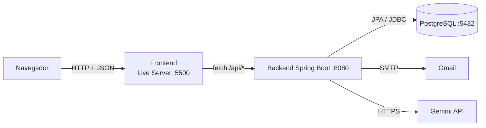
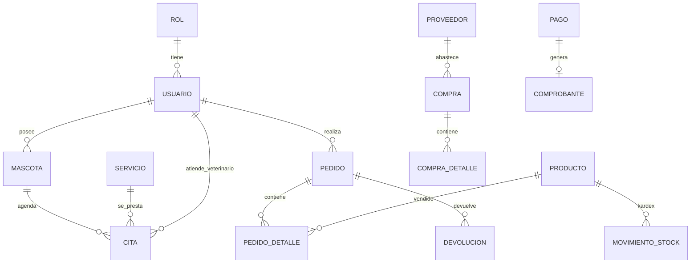

# Arquitectura de Vamos Pet

> Sistema web para una clínica veterinaria: citas, tienda (farmacia y accesorios), inventario,
> compras, devoluciones, comprobantes con QR, reportes y asistente con IA.

## 1. Visión general

| Capa | Tecnología | Ubicación |
|------|-----------|-----------|
| Frontend | HTML + CSS + JavaScript (SPA ligera, sin framework) servida con Live Server | `frontend/` |
| Backend | Java 25, Spring Boot 4.0.5 (API REST) | `backend/` |
| Base de datos | PostgreSQL (`vamospet_db`) | `db/` |
| Servicios externos | Gmail SMTP (notificaciones), Gemini (asistente de IA) | `application.properties` |

## 2. Estructura del backend (`com.vamospet.backend`)

| Paquete | Responsabilidad | Ejemplos |
|---------|----------------|----------|
| `modelo` | Entidades JPA (una por tabla) | `Usuario`, `Producto`, `Cita` |
| `repositorio` | Acceso a datos (Spring Data JPA) | `ProductoRepository` |
| `servicio` | Reglas de negocio | `InventarioService`, `AgendaService`, `ReporteService`, `ReporteExcelService`, `ReportePdfService`, `NotificacionService`, `ComprobantePdfService` |
| `controlador` | Endpoints REST `/api/...` | `UsuarioController`, `ReporteFormalController`, `PedidoDetalleController` |
| `config` | Seguridad, tareas programadas, migraciones al arranque | `SecurityConfig`, `ProgramacionConfig`, `MigracionContrasenas` |

Flujo típico: `Controlador → Servicio → Repositorio → PostgreSQL`.

## 3. Modelo de datos (resumen)

28 tablas. Las principales:

## 4. Flujos clave

- **Venta (tienda o mostrador):** el frontend valida el carrito con `POST /api/pedido-detalle/validar-stock`; si hay stock crea pedido → líneas → pago → comprobante. Cada línea genera su `Salida` en el kardex.
- **Cita:** el cliente elige especialidad y veterinario; `AgendaService` calcula franjas libres de 30 min y un índice único en BD impide dobles reservas. Un recordatorio se programa 24 h antes (tarea `@Scheduled` cada minuto).
- **Devolución:** solo de productos vendidos; reingresa al stock mediante el kardex.
- **Comprobante:** PDF con código QR que abre la verificación pública (`index.html?verificar=CODIGO`). Es un comprobante interno, no un comprobante electrónico SUNAT.

## 5. Decisiones de diseño

1. **Baja lógica** (`activo = false`) en lugar de borrar filas: se conserva el historial. (Excepción: horarios, especialidades del veterinario, costos adicionales y notificaciones programadas se borran de verdad.)
2. **Kardex**: todo cambio de stock pasa por `InventarioService.registrarMovimiento`, que valida con Guava (`Preconditions`) y es transaccional. Una salida mayor al stock responde HTTP 409.
3. **Reportes con estructura común** (`ReporteService.Tabla`): un solo generador de datos y dos exportadores (`ReportePdfService`, `ReporteExcelService`).
4. **Notificaciones por canales** (`CanalNotificacion`): hoy solo correo; añadir otro canal no cambia el servicio.
5. **Franja fija de 30 minutos** por cita (constante en `AgendaService`).
6. **Seguridad por capas (preparada):** contraseñas con BCrypt (interruptor `seguridad.bcrypt.activo`), roles de PostgreSQL de mínimo privilegio (`db/04_seguridad_roles.sql`) y credenciales por variables de entorno; se activan al cierre del proyecto.

## 6. Librerías y para qué se usan

| Librería | Uso en el proyecto |
|----------|--------------------|
| Logback (SLF4J) | Registro de eventos con niveles y archivos rotativos (`logback-spring.xml`) |
| Apache Commons Lang 3 | `StringUtils` en validación de registro de usuario y RUC de proveedor |
| Guava | `ImmutableList` en `ReporteService.TIPOS`; `Preconditions` en `InventarioService` |
| Apache POI | Exportación de reportes a Excel (`ReporteExcelService`) |
| OpenPDF / ZXing | Comprobantes y reportes en PDF, código QR |
| JUnit 5 + Mockito + H2 | Pruebas unitarias con repositorios simulados y prueba de integración con base en memoria |

## 6b. Módulos clínicos y de inventario (MK16)

| Módulo | Backend | Pantallas | Tablas |
|--------|---------|-----------|--------|
| Historial médico al atender | `AtencionMedicaController` → `AtencionMedicaService` (`POST /api/citas/{id}/atender`) | Modal "Registrar atención" en `citas.html`; se ve en `mascota-detalle.html` | `historial_evento`, `vacuna`, `cita` |
| Exámenes prequirúrgicos y cirugías | `ExamenController` → `ExamenService`, `ArchivoClinicoValidador` | `examenes.html` (personal), sección "Exámenes y Cirugías" en `mascota-detalle.html` (cliente) | `orden_examen`, `archivo_examen`, `cirugia_programada` |
| Ingreso por emergencia | `EmergenciaController` → `EmergenciaService`, `TicketEmergenciaPdfService` | `emergencias.html`, botón "Vincular mascota con código" en `perfil-cliente.html` | `contacto_emergencia`, `mascota.codigo_unico_temporal` |
| Inventario por lotes (FEFO) | `InventarioService` (sobrecarga con lote), `LoteController`, `CompraController` | Kardex con lotes en `inventario.html`, lote/vencimiento en `compras.html` | `lote_producto`, `compra_detalle`, `movimiento_stock.lote_id` |

**Endpoints** (los nombres sugeridos por el equipo se respetaron):
`POST /api/veterinario/examenes/solicitar`, `GET /api/veterinario/examenes/pendientes`, `PUT /api/veterinario/examenes/evaluar/{id}`,
`POST /api/veterinario/cirugias/agendar`, `POST /api/auxiliar/examenes/subir`, `POST /api/cliente/examenes/subir-pdf`,
`POST /api/auxiliar/emergencia/registrar`, `GET /api/auxiliar/emergencia/ticket/{idMascota}`, `POST /api/cliente/vincular-mascota`,
`GET /api/examenes`, `GET /api/examenes/archivo/{id}`, `GET /api/cirugias`, `GET /api/lotes/producto/{id}`, `GET /api/lotes/por-vencer`.
Los nombres de tabla van en singular, como el resto del esquema (`orden_examen`, no `ordenes_examenes`).

**Reglas validadas en el backend (no se pueden saltar desde el frontend):**
- Estados del examen: `Pendiente` → `Resultados_Subidos` → `Apto_Cirugia` / `Rechazado` (un rechazado puede volver a subir resultados).
- Solo evalúa el veterinario que solicitó el examen (o el administrador); rechazar exige motivo.
- Una cirugía exige una aprobación `Apto_Cirugia` evaluada hace menos de 30 días **en la fecha de la cirugía**, y cada aprobación sirve una sola vez. También se aplica cuando se intenta reservar un servicio de cirugía como cita normal (`CitaController`).
- Archivos clínicos: solo PDF o JPEG, máximo 5 MB, se verifica la firma real del contenido (no solo la extensión), se rechazan PDF con JavaScript, se guardan con nombre aleatorio fuera de la carpeta pública y solo los descarga el personal o el dueño de la mascota.
- Emergencias: sin DNI ni correo; el código `VET-PET-nnnn` es único, no se reutiliza (se numera sobre `contacto_emergencia.codigo_emitido`) y se borra de la mascota al vincularla, conservando todo el historial. El código no sale en `GET /api/mascotas`.
- Lotes: `producto.stock` = suma de `lote_producto.stock_actual` (el servicio lo mantiene en una transacción); las salidas descuentan primero el lote que vence antes y **una venta nunca toma un lote vencido**; no se ingresan lotes ya vencidos; no hay cantidades negativas (`CHECK stock_actual >= 0`). `producto.fecha_vencimiento` pasa a ser el próximo vencimiento.

**Tercera forma normal (3FN):** el vencimiento y el stock dejaron de depender solo del producto (viven en el lote); los datos del acompañante de una emergencia están en `contacto_emergencia` y no en `mascota`; los archivos de un examen en `archivo_examen`. `producto.stock` queda como total derivado (desnormalización deliberada y controlada para consultar rápido).

## 7. Seguridad

| Medida | Estado | Dónde |
|--------|--------|-------|
| BCrypt para contraseñas | Implementado, se activa con `seguridad.bcrypt.activo=true` | `SecurityConfig`, `UsuarioController`, `MigracionContrasenas` |
| Roles de PostgreSQL (`app_escritura`, `app_lectura`) | Script listo | `db/04_seguridad_roles.sql` |
| Cabeceras CSP y X-Frame-Options | Activo | `SecurityConfig` |
| Autorización por rol en reportes y en listados de usuarios | Activo (por `usuarioId`) | `ReporteFormalController`, `UsuarioController` |
| Escape de HTML en el frontend | Activo (`esc()` en `app.js`) | `frontend/` |
| Autenticación con token (JWT) en toda la API | **Pendiente / mejora futura** | — |

## 8. Pruebas

- Unitarias: `AgendaServiceTest`, `InventarioServiceTest` (con lotes), `ReporteExcelServiceTest`, `ArchivoClinicoValidadorTest`, `ExamenServiceTest`, `AtencionMedicaServiceTest`, `EmergenciaServiceTest` (`.\mvnw.cmd test`), sin necesidad de PostgreSQL.
- Integración: `ReporteFormalControllerIT` con base H2 en memoria (perfil `test`).

## 9. Limitaciones conocidas

- La API todavía no usa tokens: se identifica al usuario con `usuarioId`, que un atacante podría falsificar.
- Varias consultas usan `findAll()` y filtran en memoria; con muchos datos conviene consultas con filtros en BD.
- Los reportes exportados a Excel guardan los valores como texto (igual que el PDF).
- La verificación de prefijos de RUC (10, 15, 17, 20) debe contrastarse con la normativa vigente de SUNAT.

*Nota: Documentación en proceso de actualización.*